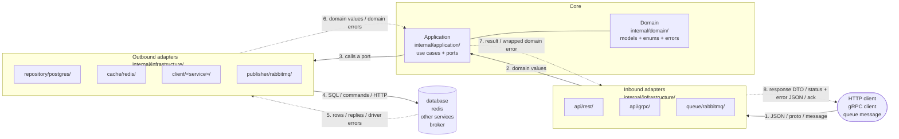

# Building a Go service

Interfaces, naming, logging and migrations follow `go-review`. Tests follow
`go-tests`. Read both; this skill does not restate them.

Paths below are relative to this skill's directory, written `<skill>` in commands.

## Structure

A request travels left to right (solid arrows, 1–4) and the response comes back right
to left (dashed arrows, 5–8):



**Request**

1. An **inbound adapter** receives the request, validates its format with the
   validator, and converts it into domain values with the request DTO's
   `toDomain()`.
2. It calls a use case on the **Application**.
3. The use case loads what it needs and checks its stateful business rules by
   calling **ports**: interfaces it declares in `application.go`. It never knows
   which adapter is behind one.
4. An **outbound adapter** implements the port: it maps domain values into its own
   struct (`mapUserRow`) and talks to the database, cache, other service or broker.

**Response**

5. The outside world answers: rows, a cached entry, an upstream reply, or a driver
   error such as `sql.ErrNoRows` or a unique violation.
6. The outbound adapter converts the answer back into domain values (`toDomain()`),
   and any error into a domain error (`domain.ErrNotFound`,
   `domain.ErrUsernameTaken`). The core never sees a driver type.
7. The use case returns the domain result, or the domain error wrapped with what it
   was doing (`fmt.Errorf("saving user: %w", err)`), or re-translated when it knows
   better.
8. The inbound adapter maps the result into its response DTO (`mapUserResponse`),
   or maps the error into a status and a client-safe error body
   (`mapErrorResponse`); a queue consumer acks, dead-letters or requeues instead.

**Imports point the other way: always toward the core.** Adapters import `domain`;
the core imports no adapter. So any adapter can be replaced without touching the
core. `cmd/service/main.go` is the one place that knows every piece, and it plugs
them together.

```
cmd/service/main.go                     wiring only
internal/config/config.go               the one config package
internal/domain/{domain,enums,errors}.go  models; string enums; error values
internal/application/application.go     Application, New, ports
internal/application/<method>.go        one public method per file
internal/infrastructure/<kind>/<tech>/  every adapter, inbound and outbound:
    inbound:  api/rest, api/grpc, queue/rabbitmq
    outbound: repository/postgres, cache/redis, client/<service>, publisher/rabbitmq
migration/                              database migrations, at the root
api/  rabbitmq/  redis/  …               other infra config, one root folder each
```

The full tree, the request flow and a "what goes where" table are in
`references/architecture.md`.

## Rules

- **Dependencies point inward.** Infrastructure → application → domain. The domain
  imports nothing from the service; the application imports only the domain.
- **Domain structs carry no tags.** Serialisation belongs to the adapter that needs it.
- **The domain holds business concepts only:** models and their methods, enums,
  errors. A struct that only carries data between layers is not domain, even
  though it is a struct.
- **Enums are strings, never `iota`**, in `domain/enums.go`, each with a `Valid()`
  method that is the only list of its values. Values that matter to one adapter
  only stay in that adapter as plain strings.
- **Logic that depends only on an entity's own data is a method on it** in the
  domain: transitions, derived values, eligibility.
- **`application.go` holds only** the `Application` struct, `New` and the ports it consumes. Use cases are methods on `*Application`.
- **One public method per file**, in snake_case: `CreateUser` lives in
  `create_user.go` with its private helpers.
- **Never share a private helper between method files.** Duplicate it under a name
  specific to each method. Example: `CreateUser` and `UpdateUser` both use a shared
  `normalizeEmail` that trims and lowercases. Signup then has to strip `+alias` parts
  to stop people opening duplicate accounts, so someone edits `normalizeEmail`, and
  `UpdateUser` now silently rewrites the address of every user who saves
  `me+work@x.com`. Nothing in `update_user.go` changed, so no reviewer looks there.
  With `normalizeCreateUserEmail` and `normalizeUpdateUserEmail`, the change stays
  in the one file it was meant for. Full code in `references/application.md`.
- **Every package exposes `New`**: `postgres.New(db)`, `redis.New(client, repo)`,
  `application.New(repo)`. Never `NewPostgresRepository`.
- **`init` is forbidden, always.** It runs at import time, in an order nobody chose,
  and cannot be tested or skipped. The work goes in `New` or in `main`.
- **Every adapter owns its structs.** `dto.go` has the adapter's tagged structs
  with a `toDomain()` method; `mappers.go` has `map<Target>(domain…) Target`
  functions for the other direction. **Target** is the adapter struct being built:
  the DTO or struct that adapter sends or stores.

  | Adapter | Target struct | Mapper |
  |---|---|---|
  | REST | `UserResponse` | `mapUserResponse(user domain.User) UserResponse` |
  | gRPC | `*pb.User` (generated message) | `mapUserMessage(user domain.User) *pb.User` |
  | repository | `userRow` | `mapUserRow(user domain.User) userRow` |
  | cache | `userEntry` | `mapUserEntry(user domain.User) userEntry` |
  | publisher | `userCreatedMessage` | `mapUserCreatedMessage(user domain.User) userCreatedMessage` |

  The mapper is named after what it returns, not what it takes, so the call site
  says what you get back: `mapUserResponse(user)` reads as "a UserResponse from
  this user". A mapper may take several domain values:
  `mapOrderResponse(order, customer) OrderResponse`.
- **Secrets never reach output.** Leave them out of response DTOs and messages
  entirely; clear them from what a repository returns after a write.
- **Logging PII or PCI data is absolutely forbidden. No exceptions.** No names,
  emails, phone numbers, addresses, national IDs, card numbers, CVVs, passwords or
  tokens, in any log line, at any level. This includes **error messages**, because
  errors end up in logs: wrap with IDs (`fmt.Errorf("saving user %d: %w", id, err)`),
  never with the value (`"saving user ana@x.com"`). Never log a request body, a DTO
  or a domain struct whole. If a value is needed to debug, log its ID.
- **`ctx context.Context` comes first** in every port and service method.
- **Every layer validates what only it can know.** The API checks the request's
  format with go-playground/validator tags on its DTO (types, required, lengths,
  enums, rules between fields). The application checks **stateful business
  rules** in a private, pure `validate<Method>`. The store enforces relational
  rules (unique, foreign keys), which the repository translates.
- **Errors are plain values in `domain/errors.go`:** five generic kinds
  (`ErrNotFound`, `ErrConflict`, `ErrInvalid`, `ErrUnavailable`, `ErrInternal`) and
  specific errors that wrap one (`ErrUsernameTaken` wraps `ErrConflict`). Every
  error leaving an outbound adapter is a domain error; inbound adapters turn them
  into a status and a fixed message. `err.Error()` never reaches a client.

## What are you doing?

| Task | Read |
|---|---|
| a new service | `references/new-service.md` |
| an endpoint or use case | the steps below |
| a model, enum, entity method or error | `references/domain.md` |
| how a use case should orchestrate ports | `references/application.md` |
| a validation rule, anywhere | `references/validation.md` |
| how an error should travel or be returned | `references/errors.md` |
| a database store | `references/repository.md` |
| a cache | `references/cache.md` |
| publishing or consuming messages | `references/queue.md` |
| calling another service | `references/clients.md` |
| a REST handler | `references/rest.md` |
| a gRPC service | `references/grpc.md` |
| `main.go` or config | `references/wiring.md` |

## Adding an endpoint

Work through the steps in order. **Read each step's reference when you reach it**,
not before. Open the matching template in `assets/templates/` before writing a file:
it is the canonical shape, not code to copy. Run `go build ./...` at the end of every step; the next
step starts from code that compiles. After each step, say in one line what was added.
Stop and ask only when a step needs a decision the request did not make: a field
name, a rule, a status, which store.

1. **Domain** (`domain.md`). Add or extend the model in `domain.go`, any enum in
   `enums.go`, and entity methods for logic on its own data. Add a specific error to
   `errors.go`, wrapping a kind, for each failure a caller must be told precisely.
2. **Port** (`application.md`). Add the method the use case needs to the consumed
   interface in `application.go`, in domain types, `ctx` first. Add a new interface
   only for a new kind of dependency.
3. **Outbound adapter** (`repository.md`, `cache.md`, `clients.md` or `queue.md`).
   Implement the port: structs in `dto.go`, `mappers.go`, the method, and error
   translation into domain errors. Add each new named constraint to
   `constraintErrors`. If a decorator wraps the port, implement the method there
   too.
4. **Use case** (`application.md`, `validation.md`). Create
   `application/<method_name>.go`: load, check stateful rules with
   `validate<Method>`, decide, persist, side effects, in that order. Wrap,
   re-translate or deliberately swallow every port error.
5. **Inbound adapter** (`rest.md`, `grpc.md` or `queue.md`; `validation.md`,
   `errors.md`). Request DTO with validator tags and `toDomain()`; response DTO
   without secrets and its `map<Response>`; the route in its own file; the route
   registered in `New` and the use case added to the `Application` interface in
   `handler.go`; a row in the error table for each new specific error.
6. **Wiring** (`wiring.md`). Construct each new adapter in `main.go` with `New` and
   pass it to whatever consumes it. New config goes in `internal/config`.
7. **Tests.** Follow `go-tests`: unit tests for the use case and the handler,
   integration tests for the repository. Assert errors with `ErrorIs`/`ErrorAs`.
8. **Check.** `go build ./...`, `go vet ./...`, `go test ./...`, then
   `go -C <skill>/scripts run ./check "$PWD"`, then the diff against `go-review`.

## The checker

`scripts/check` uses only the standard library and runs with the Go toolchain the
service already needs. `go -C` runs it in its own module, so pass an absolute path:

```bash
go -C <skill>/scripts run ./check "$PWD"
```

It parses the service and reports, as `file:line: message`: tags in the domain,
`iota` or non-string enums, enums without `Valid()`, wrong dependency direction, a
missing `application.go` or `Application` struct, more than one public method per
file or a misnamed one, private helpers shared across method files, `init`, `NewX`
constructors, misnamed mappers, functions in `dto.go`, secret-looking fields in
response DTOs and published messages, port and use case methods without `ctx`
first, and `TODO` left in migrations. Exit 1 on findings. Fix every finding before
reporting the work done.

## Templates

`assets/templates/` holds one template per file role, tech-agnostic. They show the
shape every file takes, with `Entity` as the placeholder name; they are not code to
copy or render. Write the real code for the real tech, following the shape.

| Template | Shape of |
|---|---|
| `domain/domain.go.tmpl`, `enums.go.tmpl`, `errors.go.tmpl` | the domain files |
| `application/application.go.tmpl` | `Application`, `New`, ports |
| `application/method.go.tmpl` | a use case file with its `validate<Method>` |
| `inbound/handler.go.tmpl`, `route.go.tmpl`, `dto.go.tmpl`, `mappers.go.tmpl` | an API adapter, REST shown |
| `outbound/adapter.go.tmpl`, `dto.go.tmpl`, `mappers.go.tmpl` | any outbound adapter; the store-specific pieces are named functions explained in `references/repository.md` |
| `config/config.go.tmpl`, `cmd/main.go.tmpl` | config and wiring |

## Not decided yet

These are still open and will be settled together. Until then, keep the current
behaviour and do not invent new rules for them:

- **Logging**: how the logger is built and handed to adapters, and how 5xx errors
  are logged. The PII/PCI rule above already applies.
- **The error body's shape**, including whether to adopt RFC 9457 Problem Details.
- **422 or 400** for invalid fields.
- **Rule codes**: validator tag names (`max`, `eqfield`) or our own words.
