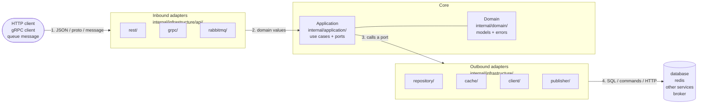

# Building a Go service

Interfaces, naming, logging and migrations follow `go-review`. Tests follow
`go-tests`. Read both; this skill does not restate them.

Paths below are relative to this skill's directory, written `<skill>` in commands.

## Structure

A request travels left to right and the answer comes back the same way:



1. An **inbound adapter** receives the request, validates its shape and converts it
   into domain values.
2. It calls a use case on the **Application**.
3. The use case does its work by calling **ports**: interfaces it declares in
   `application.go`. It never knows which adapter is behind one.
4. An **outbound adapter** implements the port, talking to the database, cache,
   other service or broker, and converts the result back into domain values.

On the way back, each layer converts again: rows → domain → response DTO, and driver
errors → domain errors → status codes.

**Imports point the other way: always toward the core.** Adapters import `domain`;
the core imports no adapter. So any adapter can be replaced without touching the
core. `cmd/service/main.go` is the one place that knows every piece, and it plugs
them together.

```
cmd/service/main.go                     wiring only
internal/config/config.go               the one config package
internal/domain/{domain,errors}.go      models; error vocabulary
internal/application/application.go     Application, New, ports
internal/application/<method>.go        one public method per file
internal/infrastructure/api/<proto>/    rest, grpc, rabbitmq: inbound
internal/infrastructure/<kind>/<tech>/  repository, cache, client, publisher: outbound
migration/                              golang-migrate SQL
```

The full tree, the request flow and a "what goes where" table are in
`references/architecture.md`.

## Rules

- **Dependencies point inward.** Infrastructure → application → domain. The domain
  imports nothing from the service; the application imports only the domain.
- **Domain structs carry no tags.** Serialisation belongs to the adapter that needs it.
- **`application.go` holds only** the `Application` struct, `New` and the ports it consumes. Use cases are methods on `*Application`.
- **One public method per file**, in snake_case: `CreateUser` lives in
  `create_user.go` with its private helpers.
- **Never share a private helper between method files.** Duplicate it under a name
  specific to each method. Example: `CreateUser` and `UpdateUser` both use a shared
  `normalizeEmail` that trims and lowercases. Signup then has to strip `+alias` parts
  to stop people opening duplicate accounts, so someone edits `normalizeEmail`, and
  `UpdateUser` now silently rewrites the address of every user who saves
  `me+work@x.com`. Nothing in `update_user.go` changed, so no reviewer looks there.
  With `normalizeCreateUserEmail` and `normalizeUpdateUserEmail`, the change stays
  in the one file it was meant for. Full code in `references/application.md`.
- **Every package exposes `New`**: `postgres.New(db)`, `redis.New(client, repo)`,
  `application.New(repo)`. Never `NewPostgresRepository`.
- **`init` is forbidden, always.** It runs at import time, in an order nobody chose,
  and cannot be tested or skipped. The work goes in `New` or in `main`.
- **Every adapter owns its structs.** `dto.go` has tagged structs with `toDomain()`;
  `mappers.go` has `map<Target>(domain…) Target` functions (`mapUserResponse`).
- **Secrets never reach output.** Leave them out of response DTOs and messages
  entirely; clear them from what a repository returns after a write.
- **`ctx context.Context` comes first** in every port and service method.
- **Errors are translated at every boundary.** Adapters turn driver, library and
  upstream errors into domain errors; inbound adapters turn domain errors into a
  status and a fixed message. `err.Error()` never reaches a client.

## What are you doing?

| Task | Read |
|---|---|
| a new service | `references/scaffold.md`, then run `scripts/scaffold` |
| an endpoint or use case | the steps below |
| a model, invariant or error kind | `references/domain.md` |
| how a use case should orchestrate ports | `references/application.md` |
| a validation rule, anywhere | `references/validation.md` |
| how an error should travel or be returned | `references/errors.md` |
| a database store | `references/repository.md` |
| a cache | `references/cache.md` |
| publishing or consuming messages | `references/queue.md` |
| calling another service | `references/clients.md` |
| a REST handler | `references/rest.md` |
| a gRPC service | `references/grpc.md` |
| `main.go` or config | `references/wiring.md` |

## Adding an endpoint

Work through the steps in order. **Read each step's reference when you reach it**,
not before. Open the matching template in `assets/templates/` before writing a file:
it is the canonical shape. Run `go build ./...` at the end of every step; the next
step starts from code that compiles. After each step, say in one line what was added.
Stop and ask only when a step needs a decision the request did not make: a field
name, a rule, a status, which store.

1. **Domain** (`domain.md`). Add or extend the model in `domain.go`. Add a pure
   invariant as an entity method. Add a sentinel to `errors.go` only if a caller must
   react to it differently.
2. **Port** (`application.md`). Add the method the use case needs to the consumed
   interface in `application.go`, in domain types, `ctx` first. Add a new interface
   only for a new kind of dependency.
3. **Outbound adapter** (`repository.md`, `cache.md`, `clients.md` or `queue.md`).
   Implement the port: structs in `dto.go`, `mappers.go`, the method, and error
   translation into domain errors. Add new unique constraints to `uniqueFields`. If
   a decorator wraps the port, implement the method there too.
4. **Use case** (`application.md`, `validation.md`). Create
   `application/<method_name>.go`: business rules, loads, decisions, persistence,
   side effects, in that order. Wrap, re-translate or deliberately swallow every
   port error.
5. **Inbound adapter** (`rest.md`, `grpc.md` or `queue.md`; `validation.md`,
   `errors.md`). Request DTO with validation tags and `toDomain()`, response DTO
   without secrets and its `map<Response>`, the handler, the method added to the
   adapter's `Application` interface, the route. Errors go through the adapter's single
   error mapper.
6. **Wiring** (`wiring.md`). Construct each new adapter in `main.go` with `New` and
   pass it to whatever consumes it. New config goes in `internal/config`.
7. **Tests.** Follow `go-tests`: unit tests for the use case and the handler,
   integration tests for the repository. Assert errors with `ErrorIs`/`ErrorAs`.
8. **Check.** `go build ./...`, `go vet ./...`, `go test ./...`, then
   `go -C <skill>/scripts run ./check "$PWD"`, then the diff against `go-review`.

## Scripts

Both use only the standard library and run with the Go toolchain the service already
needs. `go -C` runs them in their own module, so pass absolute paths.

```bash
go -C <skill>/scripts run ./scaffold -module github.com/acme/users -dir "$PWD/users" \
  -entity User -fields "Username:string:unique,Password:string:secret" -store postgres
go -C <skill>/scripts run ./check "$PWD"
```

- **scaffold** renders a complete, compiling service: domain, application, REST
  with validation and error mapping, a repository with error translation,
  migrations, config, `main.go`, `Dockerfile`; optionally `-cache` and `-grpc`.
  Flags and follow-up steps are in `references/scaffold.md`.
- **check** parses the service and reports, as `file:line: message`: tags in the
  domain, wrong dependency direction, a missing `application.go`, more than one
  public method per file or a misnamed one, private helpers shared across method
  files, `init`, `NewX` constructors, misnamed mappers, functions in `dto.go`,
  secret-looking fields in response DTOs, port and service methods without `ctx`
  first, and `TODO` left in migrations. Exit 1 on findings. Fix every finding before
  reporting the work done.

## Templates

`assets/templates/` holds every file of the layout as a Go `text/template`:
`base/` (always), `postgres/` or `mysql/`, `cache-redis/`, `grpc/`. The scaffold
renders them; when writing by hand, read the matching one and follow its shape,
substituting the placeholders (`{{.Entity}}`, `{{.Var}}`, `{{.Table}}`, `{{range .Fields}}`).
