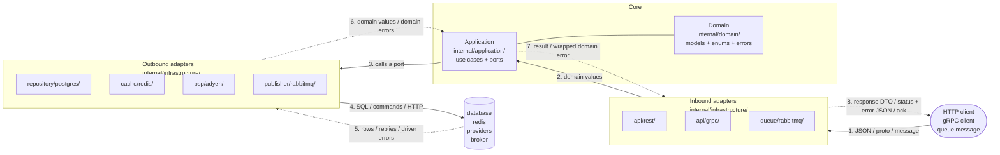

# Building a Go service

Interfaces, naming, logging and migrations follow `go-review`. Tests follow
`go-tests`. Read both; this skill does not restate them.

## Structure

A request travels left to right (solid arrows, 1–4) and the response comes back right
to left (dashed arrows, 5–8):



**Request**

1. An **inbound adapter** receives the request, validates its format with the
   validator, and converts it into domain values with the request DTO's
   `toDomain()`.
2. It calls a use case on the **Application**.
3. The use case loads what it needs and checks its stateful business rules by
   calling **ports**: interfaces it declares in `application.go`. It never knows
   which adapter is behind one.
4. An **outbound adapter** implements the port: it maps domain values into its own
   struct (`mapUserRow`) and talks to the database, cache, provider or broker.

**Response**

5. The outside world answers: rows, a cached entry, an upstream reply, or a driver
   error such as `sql.ErrNoRows` or a unique violation.
6. The outbound adapter converts the answer back into domain values (`toDomain()`),
   and any error into a domain error (`domain.ErrNotFound`,
   `domain.ErrUsernameTaken`). The core never sees a driver type.
7. The use case returns the domain result, or the domain error wrapped with what it
   was doing (`fmt.Errorf("saving user: %w", err)`), or re-translated when it knows
   better.
8. The inbound adapter maps the result into its response DTO (`mapUserResponse`),
   or maps the error into a status and a client-safe error body
   (`mapErrorResponse`); a queue consumer acks, dead-letters or requeues instead.

**Imports point the other way: always toward the core.** Adapters import `domain`;
the core imports no adapter. So any adapter can be replaced without touching the
core. Each entry point's `cmd/<entrypoint>/main.go` is the one place that knows the
pieces it uses, and it plugs
them together.

```
cmd/<entrypoint>/main.go                wiring for one entry point: rest, grpc, consumer, cli
cmd/<entrypoint>/config.go              its private config
internal/domain/{domain,enums,errors}.go  models; string enums; error values
internal/application/application.go     Application, New, ports
internal/application/<method>.go        one public method per file
internal/infrastructure/<kind>/<tech>/  every adapter, inbound and outbound:
    inbound:  api/rest, api/grpc, queue/rabbitmq
    outbound: repository/postgres, cache/redis, publisher/rabbitmq, psp/adyen, auth/cognito
pkg/<name>/                             library-like code the service needs, one package per purpose
migration/                              database migrations, at the root
api/  rabbitmq/  redis/  …               other infra config, one root folder each
```

The full tree, the request flow and a "what goes where" table are in
`references/architecture.md`.

## Rules

- **Adapters live at `internal/infrastructure/<kind>/<tech>/`.** The **kind** is the
  role the adapter plays, named for what it does for us (`repository`, `cache`,
  `publisher`, `psp`, `auth`, `api`, `queue`). The **tech** is the concrete
  technology or provider (`postgres`, `redis`, `rabbitmq`, `adyen`, `stripe`,
  `cognito`, `rest`, `grpc`). Outbound, the kind names the port and the
  struct: `psp/adyen` implements the `PSP` port with `adyen.PSP`. Full definitions
  and examples: "Kinds and techs" in `references/architecture.md`.
- **Dependencies point inward.** Infrastructure → application → domain. The domain
  imports nothing from the service; the application imports only the domain.
- **`pkg/` holds library-like code**: logic the service needs that stands on its
  own and could be exported, small libraries we write ourselves, and everything
  that would otherwise be a "utility". Each lives in its own package named for what
  it does (`pkg/retry`, `pkg/money`), never `pkg/utils`. A `pkg/` package imports
  nothing from `internal/`, so any layer may import it.
- **Domain structs carry no tags.** Serialisation belongs to the adapter that needs it.
- **The domain holds business concepts only:** models and their methods, enums,
  errors.
- **Enums are strings, never `iota`**, in `domain/enums.go`, each with a `Valid()`
  method that is the only list of its values. Values that matter to one adapter
  only stay in that adapter as plain strings.
- **Logic that depends only on an entity's own data is a method on it** in the
  domain: transitions, derived values, eligibility.
- **`application.go` holds only** the `Application` struct, `New` and the ports it consumes. Use cases are methods on `*Application`.
- **One public method per file**, in snake_case: `CreateUser` lives in
  `create_user.go` with its private helpers.
- **Never share a private helper between method files.** Duplicate it under a name
  specific to each method. Example: `CreateUser` and `UpdateUser` both use a shared
  `normalizeEmail` that trims and lowercases. Signup then has to strip `+alias` parts
  to stop people opening duplicate accounts, so someone edits `normalizeEmail`, and
  `UpdateUser` now silently rewrites the address of every user who saves
  `me+work@x.com`. Nothing in `update_user.go` changed, so no reviewer looks there.
  With `normalizeCreateUserEmail` and `normalizeUpdateUserEmail`, the change stays
  in the one file it was meant for. Full code in `references/application.md`.
- **Databases are queried with plain SQL. Never GORM or any other ORM.** Each
  repository method writes its SQL directly through `database/sql` or the driver
  (`pgx`). With AI writing the code, SQL costs nothing extra, and every query stays
  visible, reviewable and tunable in the repository that runs it.
- **Every package exposes `New`**: `postgres.New(db)`, `redis.New(client, repo)`,
  `application.New(repo)`. Never `NewPostgresRepository`.
- **`init` is forbidden, always.** It runs at import time, in an order nobody chose,
  and cannot be tested or skipped. The work goes in `New` or in `main`.
- **`panic` is forbidden, always.** Every failure is returned as an error. The one
  place the program may stop is `main`, at startup: when config is invalid or a
  connection cannot be made, `run` returns the error and `main` logs it and exits
  (`os.Exit(1)`, or `log.Fatal`).
- **Every adapter owns its structs.** `dto.go` has the adapter's tagged structs
  with a `toDomain()` method; `mappers.go` has `map<Target>(domain…) Target`
  functions for the other direction. **Target** is the adapter struct being built:
  the DTO or struct that adapter sends or stores.

  | Adapter | Target struct | Mapper |
  |---|---|---|
  | REST | `UserResponse` | `mapUserResponse(user domain.User) UserResponse` |
  | gRPC | `*pb.User` (generated message) | `mapUserMessage(user domain.User) *pb.User` |
  | repository | `userRow` | `mapUserRow(user domain.User) userRow` |
  | cache | `userEntry` | `mapUserEntry(user domain.User) userEntry` |
  | publisher | `userCreatedMessage` | `mapUserCreatedMessage(user domain.User) userCreatedMessage` |

  The mapper is named after what it returns, not what it takes, so the call site
  says what you get back: `mapUserResponse(user)` reads as "a UserResponse from
  this user". A mapper may take several domain values:
  `mapOrderResponse(order, customer) OrderResponse`.
- **Secrets never reach output.** Leave them out of response DTOs and messages
  entirely; clear them from what a repository returns after a write.
- **Logging PII or PCI data is absolutely forbidden.** No names, emails, phone
  numbers, addresses, national IDs, card numbers, CVVs, passwords or tokens, in any
  log line, at any level; a masked value is allowed. This includes **error messages**, because
  errors end up in logs: wrap with IDs (`fmt.Errorf("saving user %d: %w", id, err)`),
  never with the value (`"saving user ana@x.com"`). Never log a request body, a DTO
  or a domain struct whole. If a value is needed to debug, log its ID.
- **Logging** (`references/logging.md`): the logger is set once in `main` as the
  default, and code calls the context variants (`slog.InfoContext(ctx, …)`).
  Structured lines with named fields. Every error is logged once, where it stops;
  never logged and returned. Every request produces one line when it finishes.
- **Each entry point loads its config in `cmd/<entrypoint>/config.go`**: a private
  `config` struct read inline from environment variables with the standard
  library, every variable required, stopping at the first missing or invalid one. There
  is one `Application`, and every entry point builds all of it, so each reads the
  settings the application needs plus its own server settings.
- **Go 1.27 by default** (`go 1.27` in `go.mod`, `golang:1.27` to build), and
  **`chi`** (`github.com/go-chi/chi/v5`) as the HTTP router.
- **Code carries no comments that restate it.** A comment is only for a decision a
  reader could not work out from the code itself. This holds everywhere: domain,
  application, adapters, `pkg/`, tests.
- **`ctx context.Context` comes first** in every port and service method.
- **Every layer validates what only it can know.** The API checks the request's
  format with go-playground/validator tags on its DTO (types, required, lengths,
  enums, rules between fields). The application checks **stateful business
  rules** in a private, pure `validate<Method>`. The store enforces relational
  rules (unique, foreign keys), which the repository translates.
- **Errors are plain values in `domain/errors.go`:** five generic kinds
  (`ErrNotFound`, `ErrConflict`, `ErrInvalid`, `ErrUnavailable`, `ErrInternal`) and
  specific errors that wrap one (`ErrUsernameTaken` wraps `ErrConflict`). Every
  error leaving an outbound adapter is a domain error; inbound adapters turn them
  into a status and a fixed message. `err.Error()` never reaches a client.

## What are you doing?

| Task | Read |
|---|---|
| a new service | `references/new-service.md` |
| an endpoint or use case | the steps below |
| a model, enum, entity method or error | `references/domain.md` |
| how a use case should orchestrate ports | `references/application.md` |
| a validation rule, anywhere | `references/validation.md` |
| how an error should travel or be returned | `references/errors.md` |
| a database store | `references/repository.md` |
| a cache | `references/cache.md` |
| publishing or consuming messages | `references/queue.md` |
| calling another service or provider (payments, auth, …) | `references/providers.md` |
| a REST handler | `references/rest.md` |
| a gRPC service | `references/grpc.md` |
| an entry point, `main.go` or config | `references/wiring.md` |
| what to log, where, at which level | `references/logging.md` |

## Adding an endpoint

Work through the steps in order. **Read each step's reference when you reach it**,
not before. The code in each reference shows the shape every file takes; write the
real code for the service's tech following that shape. Run `go build ./...` at the end of every step; the next
step starts from code that compiles. After each step, say in one line what was added.
Stop and ask only when a step needs a decision the request did not make: a field
name, a rule, a status, which store.

1. **Domain** (`domain.md`). Add or extend the model in `domain.go`, any enum in
   `enums.go`, and entity methods for logic on its own data. Add a specific error to
   `errors.go`, wrapping a kind, for each failure a caller must be told precisely.
2. **Port** (`application.md`). Add the method the use case needs to the consumed
   interface in `application.go`, in domain types, `ctx` first. Add a new interface
   only for a new kind of dependency.
3. **Outbound adapter** (`repository.md`, `cache.md`, `providers.md` or `queue.md`).
   Implement the port: structs in `dto.go`, `mappers.go`, the method, and error
   translation into domain errors. Add each new named constraint to
   `constraintErrors`. If a decorator wraps the port, implement the method there
   too.
4. **Use case** (`application.md`, `validation.md`). Create
   `application/<method_name>.go`: load, check stateful rules with
   `validate<Method>`, decide, persist, side effects, in that order. Wrap,
   re-translate or deliberately swallow every port error.
5. **Inbound adapter** (`rest.md`, `grpc.md` or `queue.md`; `validation.md`,
   `errors.md`). Request DTO with validator tags and `toDomain()`; response DTO
   without secrets and its `map<Response>`; the route in its own file; the route
   registered in `New` and the use case added to the `Application` interface in
   `handler.go`; a row in the error table for each new specific error.
6. **Wiring** (`wiring.md`). Construct each new adapter in `main.go` with `New` and
   pass it to whatever consumes it. A new setting for the application goes in every
   entry point's `config.go`.
7. **Tests.** Follow `go-tests`: unit tests for the use case and the handler,
   integration tests for the repository. Assert errors with `ErrorIs`/`ErrorAs`.
8. **Check.** `go build ./...`, `go vet ./...`, `go test ./...`, then the
   checklist below, then the diff against `go-review`.

## Checklist before reporting done

Walk through every item against the changed code. Fix what fails; do not report
the work done with an item failing.

- [ ] No struct tags on anything in `internal/domain`.
- [ ] Enums are string types in `domain/enums.go`, no `iota`, each with `Valid()`.
- [ ] `domain` imports nothing from the service; `application` imports only `domain`.
- [ ] `application.go` holds only `Application`, `New` and the ports.
- [ ] Each method file holds exactly one public method on `*Application`, and its
      snake_case name matches the method.
- [ ] No private helper is called from a method file other than its own.
- [ ] Stateful rules are in a pure `validate<Method>`, joined with `errors.Join`.
- [ ] No `func init()` anywhere, `cmd/` included.
- [ ] No `panic` anywhere; startup failures return to `main`, which logs and exits.
- [ ] No comment restates what the code does.
- [ ] Constructors are `New`, never `NewSomething`.
- [ ] `dto.go` holds structs and their `toDomain()` only; conversions the other way
      are `map<Target>` functions in `mappers.go`.
- [ ] No secret fields in response DTOs or published messages.
- [ ] `ctx context.Context` first in every port and use case method.
- [ ] Every error leaving an outbound adapter is a domain error; new named
      constraints are in `constraintErrors`; new specific errors have a row in the
      inbound adapter's error table.
- [ ] No PII or PCI in any log line or error message (masked values allowed).
- [ ] Log calls use the context variants; no error is both logged and returned.
- [ ] Queries are plain SQL; no ORM in `go.mod`.
- [ ] Every new migration column is described; nothing left as `TODO`.
