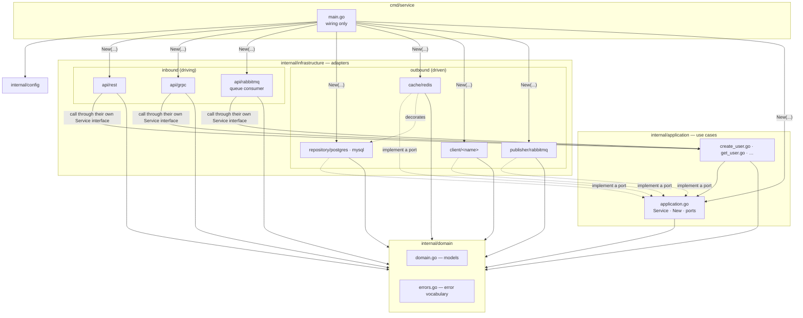
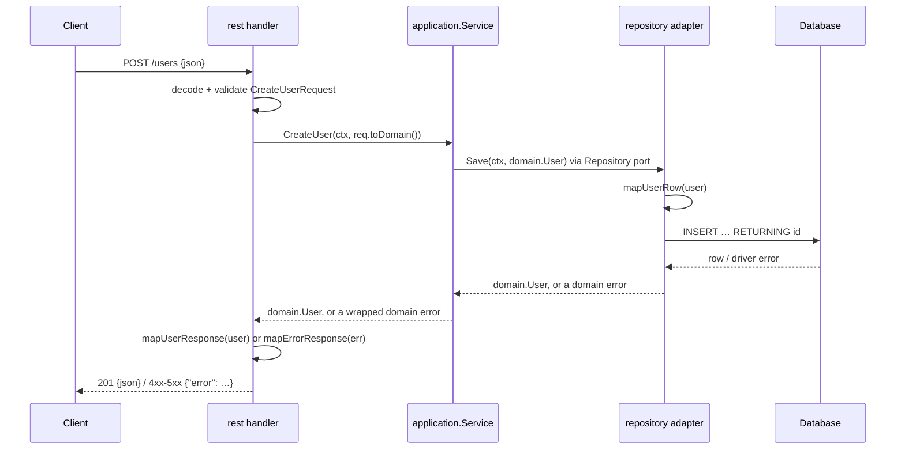

# Architecture

## Layers and dependencies



Arrows are imports. Every arrow points inward or sideways into `domain`; nothing in
`domain` or `application` imports an adapter. `scripts/check` enforces this.

## Request flow



Data changes shape at each boundary: JSON → request DTO → domain → row → SQL, and back.
Errors change shape the same way: driver error → domain error → status code + JSON body.

## Full tree

```
my-service/
├── cmd/service/main.go                      wiring: config, connections, New, serve, shutdown
├── internal/
│   ├── config/config.go                     the only config package
│   ├── domain/
│   │   ├── domain.go                        models, no tags
│   │   └── errors.go                        ErrNotFound, ErrConflict, ErrInvalid, ErrUnavailable, ViolationError
│   ├── application/
│   │   ├── application.go                   Service, New, ports (consumed interfaces)
│   │   ├── create_user.go                   one public method + its private helpers
│   │   └── get_user.go
│   └── infrastructure/
│       ├── api/
│       │   ├── rest/
│       │   │   ├── rest.go                  Handler, New, Register, handlers, Service interface
│       │   │   ├── dto.go                   request/response/error structs, toDomain()
│       │   │   ├── mappers.go               map<Target> functions, error → response
│       │   │   └── validation.go            decoding, validator setup, violation mapping
│       │   ├── grpc/
│       │   │   ├── grpc.go                  Server, New, Register, RPCs, error → status
│       │   │   ├── mappers.go               proto ↔ domain, violations → BadRequest
│       │   │   ├── validation.go            request shape checks
│       │   │   └── pb/                      generated, never edited
│       │   └── rabbitmq/                    queue consumer: Consumer, Run, ack/nack by error kind
│       ├── repository/
│       │   └── postgres/                    or mysql/
│       │       ├── postgres.go              Repository, New, port methods, error translation
│       │       ├── dto.go                   row structs, toDomain()
│       │       └── mappers.go               map<Entity>Row
│       ├── cache/redis/                     decorator over a repository port
│       ├── client/<name>/                   outbound calls to other services
│       └── publisher/rabbitmq/              Publisher port: one method per domain event
├── api/proto/<service>/v1/*.proto           contracts (OpenAPI specs live in api/ too)
├── migration/000001_<name>.{up,down}.sql    golang-migrate files
├── Dockerfile
└── go.mod
```

## What goes where

| Question | Answer |
|---|---|
| A new entity or field | `domain.go` |
| A new kind of failure | a sentinel in `errors.go`, only if a caller must react differently to it |
| A rule that needs no I/O | a method on the domain entity |
| A rule that needs state (exists, unique, limits) | the application method |
| Request shape (required, format, length) | the inbound adapter's DTO tags or validation.go |
| Anything with SQL, JSON, HTTP, Redis, proto | an adapter |
| Building and connecting things | `main.go` |
| Code another repository imports | `pkg/`, and only then |

Banned anywhere: `func init()`, `utils`/`helpers`/`common` packages, a second config
package. See `go-review` for the reasons.
