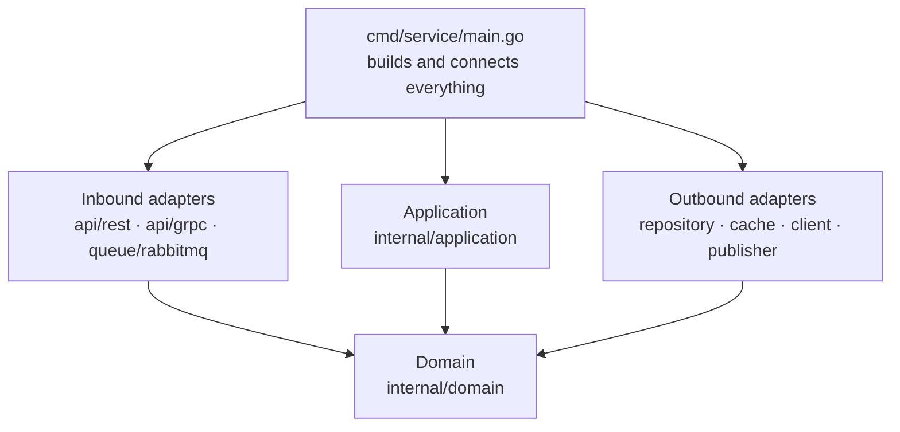
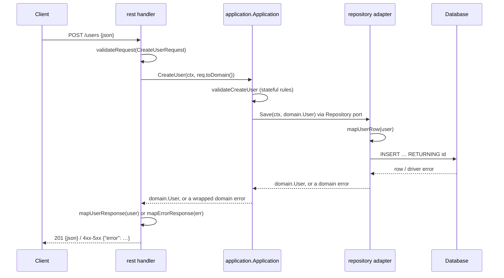

# Architecture

## Layers and dependencies



Arrows are **imports**: "A → B" means A's code imports B. This is a different view
from the request flow below, where arrows are calls.

- **Everything imports `domain`**, because domain types are the shared language.
- **`domain` imports nothing** from the service.
- **`application` imports only `domain`.** It declares ports (interfaces) and never
  names an adapter.
- **Inbound adapters do not import `application`.** Each declares its own small
  `Application` interface with the use cases it calls, and `*application.Application`
  satisfies it.
- **Outbound adapters do not import `application` either**, except a decorator such
  as the cache, which takes the port type (`application.Repository`) it wraps.
- **Only `main.go` imports everything**, to build each piece with `New` and pass it
  to the next.

`scripts/check` enforces the domain and application rules.

## Request flow



Data changes shape at each boundary: JSON → request DTO → domain → row → SQL, and back.
Errors change shape the same way: driver error → domain error → status code + JSON body.

## Full tree

Every adapter lives at `internal/infrastructure/<kind>/<tech>/`, inbound and
outbound alike. The kind says what role it plays (`api`, `queue`, `repository`,
`cache`, `client`, `publisher`); the tech says how (`rest`, `grpc`, `rabbitmq`,
`postgres`, `redis`). REST and gRPC share the kind `api`: both are APIs, gRPC through
RPCs.

Configuration for infrastructure lives **at the repository root, one folder per
piece of infra**, never inside `internal/`: `migration/` for the database, `api/` for
the API contracts, `rabbitmq/` for exchanges and queues, `redis/` for its config.

```
my-service/
├── cmd/service/main.go                      wiring: config, connections, New, serve, shutdown
├── internal/
│   ├── config/config.go                     the only config package
│   ├── domain/
│   │   ├── domain.go                        models and their methods, no tags
│   │   ├── enums.go                         string enums, each with Valid()
│   │   └── errors.go                        generic kinds + specific errors that wrap them
│   ├── application/
│   │   ├── application.go                   Application, New, ports (consumed interfaces)
│   │   ├── create_user.go                   one public method + its private helpers (validateCreateUser)
│   │   └── get_user.go
│   └── infrastructure/
│       ├── api/
│       │   ├── rest/
│       │   │   ├── handler.go               Application interface, Handler, New(router, app), shared helpers, validator
│       │   │   ├── create_user.go           one route per file
│       │   │   ├── get_user.go
│       │   │   ├── dto.go                   request (json + validate tags, toDomain), response, error DTOs
│       │   │   └── mappers.go               map<Target>, error tables, mapErrorResponse
│       │   └── grpc/
│       │       ├── server.go                Application interface, Server, New(server, app), validator
│       │       ├── create_user.go           one RPC per file
│       │       ├── dto.go                   tagged request structs, toDomain
│       │       ├── mappers.go               proto ↔ DTO/domain, error tables, mapStatus
│       │       └── pb/                      generated, never edited
│       ├── queue/
│       │   └── rabbitmq/                    consumer: tagged message DTOs, ack/nack by error kind
│       ├── repository/
│       │   └── postgres/
│       │       ├── postgres.go              Repository, New, port methods, domainError, constraintErrors
│       │       ├── dto.go                   row structs, toDomain()
│       │       └── mappers.go               map<Entity>Row
│       ├── cache/redis/                     decorator over a repository port
│       ├── client/<service>/                outbound calls to other services
│       └── publisher/rabbitmq/              Publisher port: one method per domain event
├── migration/000001_<name>.{up,down}.sql    database migrations (golang-migrate)
├── api/
│   ├── openapi.yaml                         REST contract
│   └── proto/<service>/v1/*.proto           gRPC contract
├── rabbitmq/definitions.json                exchanges, queues, bindings
├── redis/redis.conf                         cache server config
├── Dockerfile
└── go.mod
```

Only the infra folders the service actually uses exist.

## What goes where

| Question | Answer |
|---|---|
| A new entity or field | `domain/domain.go` |
| A value with a fixed set of options | a string enum in `domain/enums.go`, with `Valid()` |
| Logic that depends only on an entity's own data | a method on it in `domain/domain.go` |
| Something a caller must be told precisely | a specific error in `domain/errors.go`, wrapping a kind |
| The request's format (types, required, lengths, enums, cross-field) | validator tags on the inbound adapter's DTO |
| A stateful business rule | `validate<Method>` in the use case's file |
| Unique, foreign keys, not null | the store enforces it; the repository translates the error |
| Anything with SQL, JSON, HTTP, Redis, proto | an adapter |
| Config for a piece of infra (migrations, broker topology, cache config) | its own folder at the repository root |
| Building and connecting things | `cmd/service/main.go` |
| Code another repository imports | `pkg/`, and only then |

Banned anywhere: `func init()`, `iota` enums, `utils`/`helpers`/`common` packages, a
second config package. See `go-review` for the reasons.
