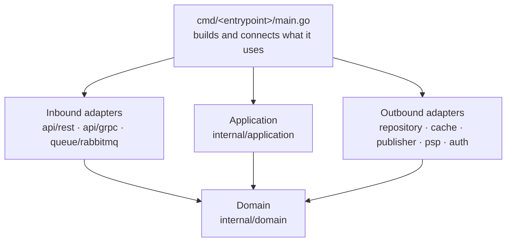
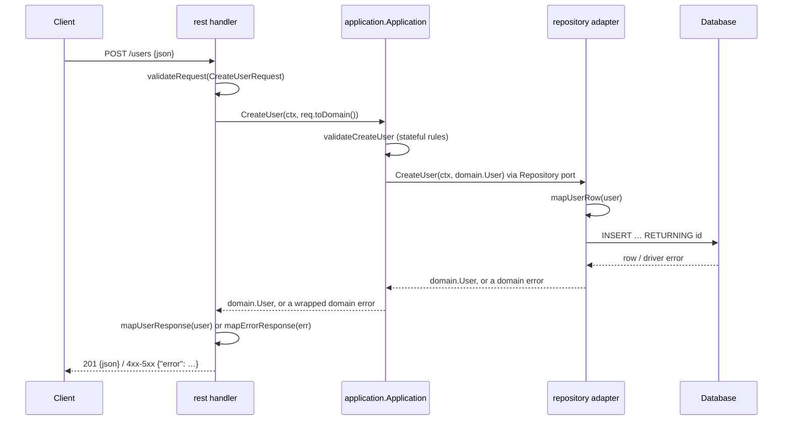

# Architecture

## Layers and dependencies



Arrows are **imports**: "A → B" means A's code imports B. This is a different view
from the request flow below, where arrows are calls.

- **Everything imports `domain`**, because domain types are the shared language.
- **`domain` imports nothing** from the service except `pkg/`.
- **`pkg/` imports nothing from `internal/`.** It is library code: standard library
  and third-party packages only, so every layer may import it. Most often it is the
  application that does.
- **`application` imports only `domain` and `pkg/`.** It declares ports (interfaces) and never
  names an adapter.
- **Inbound adapters do not import `application`.** Each declares its own small
  `Application` interface with the use cases it calls, and `*application.Application`
  satisfies it.
- **Outbound adapters do not import `application` either**, except a decorator such
  as the cache, which takes the port type (`application.Repository`) it wraps.
- **Only the entry points' `main.go` import the adapters**, to build each piece with `New` and pass it
  to the next.


## Request flow



Data changes shape at each boundary: JSON → request DTO → domain → row → SQL, and back.
Errors change shape the same way: driver error → domain error → status code + JSON body.

## Kinds and techs

Every adapter lives at `internal/infrastructure/<kind>/<tech>/`, inbound and outbound
alike.

- **Kind**: the **role** the adapter plays for the service, named for **what it does
  for us**, never for how it does it. `repository` stores our data, `psp` takes
  payments, `auth` authenticates users, `api` receives requests.
- **Tech**: the **concrete technology or provider** that plays the role: `postgres`,
  `adyen`, `cognito`, `rest`. The package is named after the tech.

| Path | Kind | Tech | Package | Struct | Port it implements |
|---|---|---|---|---|---|
| `api/rest/` | `api` | `rest` | `rest` | `Handler` | (inbound: calls `Application`) |
| `api/grpc/` | `api` | `grpc` | `grpc` | `Server` | (inbound: calls `Application`) |
| `queue/rabbitmq/` | `queue` | `rabbitmq` | `rabbitmq` | `Consumer` | (inbound: calls `Application`) |
| `repository/postgres/` | `repository` | `postgres` | `postgres` | `Repository` | `Repository` |
| `cache/redis/` | `cache` | `redis` | `redis` | `Cache` | the port it decorates |
| `publisher/rabbitmq/` | `publisher` | `rabbitmq` | `rabbitmq` | `Publisher` | `Publisher` |
| `psp/adyen/` | `psp` | `adyen` | `adyen` | `PSP` | `PSP` |
| `psp/stripe/` | `psp` | `stripe` | `stripe` | `PSP` | `PSP` |
| `auth/cognito/` | `auth` | `cognito` | `cognito` | `Auth` | `Auth` |

**Rules**

1. **The kind is the capability the adapter gives the service**: what it is for.
   A payment provider is `psp/`, an identity provider is `auth/`, a database is
   `repository/`.
2. **The tech is the concrete thing.** A protocol for inbound adapters (`rest`,
   `grpc`), a product for infrastructure (`postgres`, `redis`, `rabbitmq`), a
   provider for services we call (`adyen`, `stripe`, `cognito`).
3. **Outbound: the kind names the port and the struct.** The port in
   `application.go` is `PSP`; `adyen.PSP` and `stripe.PSP` both implement it, and
   `main.go` picks one. Swapping providers never touches the application.
4. **Inbound: the struct is named for what it is**: `Handler` for REST, `Server` for
   gRPC, `Consumer` for a queue. It calls the use cases through its own
   `Application` interface.
5. **One folder per tech.** Two providers of the same kind are two folders under the
   same kind, never one package with a switch.
6. **Kind and tech are lowercase single words**, as Go package names must be: `psp`,
   not `payment_provider`; `cognito`, not `aws-cognito`.
7. **A new kind is fine.** When a service needs a capability not listed here, name
   it for what it does (`storage/s3/`, `mailer/sendgrid/`, `geocoder/google/`).

Configuration for infrastructure lives **at the repository root, one folder per
piece of infra**: `migration/` for the database, `api/` for the API contracts,
`rabbitmq/` for exchanges and queues, `redis/` for its config.

## Full tree

```
my-service/
├── cmd/
│   ├── rest/
│   │   ├── main.go                          wiring: connections, New, serve, shutdown
│   │   └── config.go                        private config
│   └── consumer/
│       ├── main.go
│       └── config.go
├── internal/
│   ├── domain/
│   │   ├── domain.go                        models and their methods, no tags
│   │   ├── enums.go                         string enums, each with Valid()
│   │   └── errors.go                        generic kinds + specific errors that wrap them
│   ├── application/
│   │   ├── application.go                   Application, New, ports (consumed interfaces)
│   │   ├── create_user.go                   one public method + its private helpers (validateCreateUser)
│   │   └── get_user.go
│   └── infrastructure/
│       ├── api/
│       │   ├── rest/
│       │   │   ├── handler.go               Application interface, Handler, New(router, app), shared helpers, validator
│       │   │   ├── create_user.go           one route per file
│       │   │   ├── create_user_dto.go       that route's own request and response DTOs
│       │   │   ├── get_user.go
│       │   │   ├── dto.go                   DTOs several routes share, error DTOs
│       │   │   └── mappers.go               map<Target>, error tables, mapErrorResponse
│       │   └── grpc/
│       │       ├── server.go                Application interface, Server, New(server, app), validator
│       │       ├── create_user.go           one RPC per file
│       │       ├── create_user_dto.go       that RPC's own request struct
│       │       ├── dto.go                   request structs several RPCs share
│       │       ├── mappers.go               proto ↔ DTO/domain, error tables, mapStatus
│       │       └── pb/                      generated, never edited
│       ├── queue/
│       │   └── rabbitmq/                    consumer: tagged message DTOs, ack/nack by error kind
│       ├── repository/
│       │   └── postgres/
│       │       ├── postgres.go              Repository, New, domainError, constraintErrors
│       │       ├── find_user.go             one port method per file
│       │       ├── find_user_dao.go         that method's own row structs
│       │       ├── dao.go                   row structs several methods share, toDomain()
│       │       └── mappers.go               map<Entity>Row
│       ├── cache/redis/                     decorator over a repository port
│       ├── psp/adyen/                       payments through Adyen: implements the PSP port
│       ├── auth/cognito/                    authentication through Cognito: implements the Auth port
│       └── publisher/rabbitmq/              Publisher port: one method per domain event, one file each
├── pkg/
│   └── retry/                               library-like code, one package per purpose
├── migration/000001_<name>.{up,down}.sql    database migrations (golang-migrate)
├── api/
│   ├── openapi.yaml                         REST contract
│   └── proto/<service>/v1/*.proto           gRPC contract
├── rabbitmq/definitions.json                exchanges, queues, bindings
├── redis/redis.conf                         cache server config
├── Dockerfile
└── go.mod
```

Only the infra folders the service actually uses exist.

## What goes where

| Question | Answer |
|---|---|
| A new entity or field | `domain/domain.go` |
| A value with a fixed set of options | a string enum in `domain/enums.go`, with `Valid()` |
| Logic that depends only on an entity's own data | a method on it in `domain/domain.go` |
| Something a caller must be told precisely | a specific error in `domain/errors.go`, wrapping a kind |
| The request's format (types, required, lengths, enums, cross-field) | validator tags on the inbound adapter's DTO |
| A stateful business rule | `validate<Method>` in the use case's file |
| Unique, foreign keys, not null | the store enforces it; the repository translates the error |
| Anything with SQL, JSON, HTTP, Redis, proto | an adapter |
| Config for a piece of infra (migrations, broker topology, cache config) | its own folder at the repository root |
| Building and connecting things | `cmd/<entrypoint>/main.go` |
| A setting an entry point needs | that entry point's `config.go` |
| Library-like logic: exportable, a small library we write, anything that would be a "utility" | its own package under `pkg/`, named for what it does |

Banned anywhere: `func init()`, `panic`, `iota` enums, packages named
`utils`/`helpers`/`common` (in `pkg/` too: name the package for what it does). See `go-review` for the reasons.
