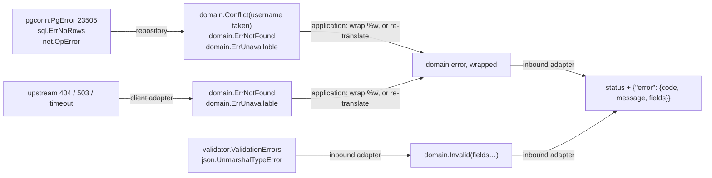

# Errors

Errors follow the same rule as data: each adapter translates into the domain's
vocabulary on the way in and out of it on the way out. Nothing outside an adapter
knows which driver, library or protocol produced an error. The vocabulary itself is in
`domain.md`.



## Rules

1. **Translate what someone can act on; wrap the rest.** A client can fix a taken
   username, retry an outage, or stop asking for a missing record. It can do nothing
   about a syntax error in your SQL. That stays a wrapped error, becomes a 500, and is
   logged.
2. **Wrap with what you were doing**: `fmt.Errorf("inserting user: %w", err)`. Wrap
   with `%w` so `errors.Is` and `errors.As` see through it. When translating and
   keeping the cause for the logs, wrap both:
   `fmt.Errorf("%s: %w: %w", doing, domain.ErrUnavailable, err)`.
3. **No PII or PCI in an error, ever.** Error messages are logged, so a wrap that
   names an email, a name or a card number leaks it into the logs. Identify things
   by ID: `fmt.Errorf("finding user %d: %w", id, err)`, `fmt.Errorf("charging order
   %d: %w", orderID, err)`. Also check what a *driver* puts in its message before
   logging it: MySQL's duplicate-key message contains the duplicated value
   (`Duplicate entry 'ana@x.com' for key …`). That is fine here only because
   conflicts become a 409 and are never logged; never log such an error.
4. **Log once, where the error stops.** For a request that is the inbound adapter,
   and only for 5xx: a 404 is an answer, not an incident. Never log and return.
5. **Never show `err.Error()` to a client.** Messages come from fixed strings and
   `ruleMessages`, keyed by kind and rule.
6. **Cancelled requests are not errors.** `context.Canceled` means the client went
   away: write nothing over REST, return `Canceled` over gRPC, log nothing.
   `context.DeadlineExceeded` is treated as unavailable.

## Outbound: databases

Each repository has one `domainError(err, doing)` function; every query's error goes
through it. Templates: `assets/templates/{postgres,mysql}/…/repository/`.

| Driver error | Domain error |
|---|---|
| `sql.ErrNoRows` | `domain.ErrNotFound` |
| Postgres `23505` (`*pgconn.PgError`), MySQL `1062` (`*mysql.MySQLError`), known constraint | `domain.Conflict(Violation{Field, "taken"})` |
| the same, unknown constraint | `ErrConflict` wrapped with the cause |
| `net.Error` (refused, reset, timeout), MySQL `ErrInvalidConn` | `ErrUnavailable` wrapped with the cause |
| anything else | wrapped, becomes a 500 |

**Constraint names map to fields** through a map literal in the repository:

```go
var uniqueFields = map[string]string{
	"users_username_key": "username",
}
```

Postgres names a `UNIQUE` column's constraint `<table>_<column>_key`. MySQL reports
the index name in its message (`for key 'users.username'`). Name constraints
explicitly in migrations when the default is unclear, and add every new unique
constraint to the map in the same change.

Other codes worth translating when a use case needs them: Postgres `23503`
(foreign key: a referenced row is missing → `Invalid` on that field), `23514` (check
constraint → `Invalid`), `40001` (serialization failure → retry in the adapter, then
`ErrConflict`).

## Outbound: caches

A cache never fails a request. Read and write errors are logged as warnings and the
decorator falls through to the repository. See `cache.md`.

## Outbound: other services

See `clients.md`. Upstream 404 → `ErrNotFound` only when it means the same thing to
our caller; 5xx, timeouts and refused connections → `ErrUnavailable`; 4xx caused by
us → wrapped, because it is our bug.

## Inbound: REST

`mapErrorResponse(err)` in `rest/mappers.go` is the only place a status code is
chosen. Order matters: the specific cases come before the general ones.

| Error | Status | `code` |
|---|---|---|
| body over 1 MiB | 413 | `body_too_large` |
| invalid JSON | 400 | `malformed_request` |
| `ViolationError` of kind conflict | 409 | `conflict` + `fields` |
| `ViolationError` | 422 | `invalid_argument` + `fields` |
| `ErrConflict` | 409 | `conflict` |
| `ErrInvalid` | 422 | `invalid_argument` |
| `ErrNotFound` | 404 | `not_found` |
| `ErrUnavailable`, `DeadlineExceeded` | 503 | `unavailable` |
| anything else | 500 | `internal`, logged |

Every error body has one shape:

```json
{
  "error": {
    "code": "invalid_argument",
    "message": "The request has invalid fields.",
    "fields": [
      {"field": "email", "rule": "email", "message": "must be a valid email address"},
      {"field": "username", "rule": "taken", "message": "is already taken"}
    ]
  }
}
```

`code` and `rule` are the contract; clients switch on them. `message` is for humans
and may change.

## Inbound: gRPC

`toStatus` in `grpc/grpc.go` maps the same kinds to codes (`InvalidArgument`,
`AlreadyExists`, `NotFound`, `Unavailable`, `Canceled`, `Internal`), and attaches
violations as `errdetails.BadRequest` field violations, so gRPC clients get the same
field-level detail.

## Testing errors

Assert kinds with `require.ErrorIs(t, err, domain.ErrConflict)` and fields with
`require.ErrorAs(t, err, &violations)`, per `go-tests`. Never assert on message text.
