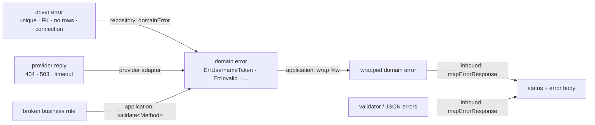

# Errors

An error changes shape at every boundary, just like data does. The error values
themselves are in `domain.md`.



## Rules

1. **Every error that leaves an outbound adapter is a domain error.** A known
   failure becomes its specific error, an unknown one its generic kind. The
   original error is wrapped inside for the logs, but nothing above the adapter
   needs to know which driver produced it.
2. **Wrap with what you were doing**, using `%w`:
   `fmt.Errorf("saving order %d: %w", id, err)`. To translate and keep the cause,
   wrap both: `fmt.Errorf("%s: %w: %w", doing, domain.ErrUnavailable, err)`.
3. **No PII or PCI in an error, ever.** Errors get logged, so a wrap that names an
   email, a name or a card number leaks it. Identify things by ID. Check what a
   driver puts in its own message too: MySQL's duplicate-key message contains the
   duplicated value.
4. **Never show `err.Error()` to a client.** The response is built from fixed codes
   and messages in the inbound adapter.
5. **A cancelled request is not an error.** `context.Canceled` means the client went
   away: write nothing. `context.DeadlineExceeded` is treated as unavailable.

## Outbound: the repository

Every query's error goes through one `domainError(err, doing)` function.

```go
var constraintErrors = map[string]error{
	"users_username_key": domain.ErrUsernameTaken,
	"users_email_key":    domain.ErrEmailTaken,
}
```

| Store says | Domain error |
|---|---|
| no rows | `ErrNotFound` |
| a constraint in `constraintErrors` | its specific error |
| any other unique violation | `ErrConflict` |
| any other integrity or data error (foreign key, not null, value too long) | `ErrInvalid` |
| connection refused, reset, timeout, server shutting down | `ErrUnavailable` |
| anything else | `ErrInternal` |

A missing foreign key is `ErrInvalid`, not `ErrNotFound`: the client referenced
something that does not exist, which is a problem with their request. `ErrNotFound`
would tell them the resource they asked for is missing.

The store-specific checks are in `repository.md`.

## Outbound: caches and providers

A cache never fails a request (`cache.md`). A provider adapter translates provider
replies the same way a repository translates drivers (`providers.md`).

## Application

Three moves:

1. **Wrap and pass through.** `fmt.Errorf("saving user: %w", err)`. The default.
2. **Re-translate when the use case knows better.** The customer repository says
   `ErrNotFound`, but for `PlaceOrder` that means the order references a customer
   that does not exist: return `domain.ErrCustomerNotFound`, which wraps
   `ErrInvalid` (400 on `customer_id`), not a 404.
3. **Return broken business rules** from `validate<Method>`, joined.

## Inbound: REST

### The error body

Every error response has the same body:

```json
{
  "type": "invalid_argument",
  "title": "The request is invalid.",
  "status": 400,
  "errors": [
    {"code": "max_length", "field": "username", "param": "32"},
    {"code": "invalid_state", "field": "status"},
    {"code": "limit_exceeded"}
  ]
}
```

| Member | Holds | Present |
|---|---|---|
| `type` | the kind of failure, a stable code clients switch on: `invalid_argument`, `not_found`, `resource_conflict`, … | always |
| `title` | the fixed human summary for that type | always |
| `status` | the HTTP status, repeated so the body stands alone in logs and queues | always |
| `errors` | each individual failure: a `code`, plus `field` when it is about one field and `param` when the rule has a value | only when there is something to list |

Field and non-field failures share the list: a failure about one field carries
`field`, one about the request as a whole (a limit reached, a state that forbids
the operation) carries only `code`. Several failures from `errors.Join` all appear, in the order of
the adapter's table.

A 404 is just:

```json
{"type": "not_found", "title": "The resource does not exist.", "status": 404}
```

The content type is `application/json`.

**All invalid input is a 400**: a body that cannot be read, a wrong type, a validator
failure and a broken business rule alike. Callers, other services especially, need
one status to handle; the `type` tells the cases apart (`malformed_request`,
`invalid_argument`).

### Choosing it

`mapErrorResponse(err)` in `rest/mappers.go` builds the body, status included; it is
the only place a status is chosen. It checks, in this order:

1. **The request itself**, errors that never reached the application:

   | Error | Status | `type` | `errors` |
   |---|---|---|---|
   | body over 1 MiB (`*http.MaxBytesError`) | 413 | `payload_too_large` | none |
   | invalid JSON (`errMalformedBody`) | 400 | `malformed_request` | none |
   | wrong JSON type (`*json.UnmarshalTypeError`) | 400 | `invalid_argument` | `{code: invalid_type, field, param: integer}` |
   | validator failure (`validator.ValidationErrors`) | 400 | `invalid_argument` | one per failed rule |

2. **Specific domain errors**, from the adapter's table. Every row whose error
   matches with `errors.Is` adds an entry, so joined errors all appear:

   ```go
   var domainErrors = []struct {
   	err    error
   	status int
   	code   string
   	field  string
   }{
   	{domain.ErrUsernameTaken, http.StatusConflict, "value_taken", "username"},
   	{domain.ErrOrderAlreadyShipped, http.StatusBadRequest, "invalid_state", "status"},
   	{domain.ErrCreditLimitExceeded, http.StatusBadRequest, "limit_exceeded", ""},
   }
   ```

   Field names live here, in the adapter, because only the adapter knows the names
   its clients use. A failure about the request as a whole has an empty `field`.

3. **Generic kinds**, which give the `type` and `title`, and the status when no row
   matched:

   | Kind | Status | `type` |
   |---|---|---|
   | `ErrNotFound` | 404 | `not_found` |
   | `ErrConflict` | 409 | `resource_conflict` |
   | `ErrInvalid` | 400 | `invalid_argument` |
   | `ErrUnavailable`, `context.DeadlineExceeded` | 503 | `service_unavailable` |
   | `ErrInternal`, anything else | 500 | `internal_error` |

### Codes

Every `type` and every `code` is our own word. The validator's tags, driver codes
and provider codes are all translated in the adapter, so a response never reveals
which libraries or providers the service uses.

**Naming rule:** snake_case, formal, and naming the problem. Two words when two are
enough (`value_taken`, `max_length`); up to five or six when that is what makes it
understandable (`greater_than_or_equal`). Generic, so the same code fits any service:
`value_taken`, not `username_taken`. A new code is added only when no existing one
describes the problem.

**`param` is optional**: include it only when the extra value makes the error
clearer than the code alone. A limit, a bound or an expected type does (`max_length`
with `32`); a code that already says everything does not (`invalid_email`,
`value_required`, `invalid_option`).

`type` values:

| `type` | When |
|---|---|
| `invalid_argument` | the request breaks a rule |
| `malformed_request` | the body cannot be read |
| `payload_too_large` | the body is over the limit |
| `not_found` | the resource does not exist |
| `resource_conflict` | the request clashes with existing data |
| `service_unavailable` | a dependency is down |
| `internal_error` | anything unexpected |

`code` values from the validator, translated in the adapter:

| Validator tag | `code` | `param` |
|---|---|---|
| `required`, `required_if`, `required_unless`, `required_with`, `required_without` | `value_required` | |
| `max`, `lte` on text, lists, maps | `max_length` | the limit |
| `min`, `gte` on text, lists, maps | `min_length` | the limit |
| `len` | `length_mismatch` | the length |
| `max`, `lte` on numbers | `less_than_or_equal` | the bound |
| `lt` on numbers | `less_than` | the bound |
| `min`, `gte` on numbers | `greater_than_or_equal` | the bound |
| `gt` on numbers | `greater_than` | the bound |
| `oneof`, `enum` | `invalid_option` | |
| `email` | `invalid_email` | |
| `url`, `uri` | `invalid_url` | |
| `uuid` | `invalid_uuid` | |
| `e164` | `invalid_phone` | |
| `datetime` | `invalid_date` | |
| `eqfield` | `field_mismatch` | |
| `unique` | `duplicate_value` | |
| a JSON value of the wrong type | `invalid_type` | the JSON type expected |
| any tag not in the table | `invalid_value` | |

A tag that keeps showing up as `invalid_value` needs its own row.

`code` values from the domain are chosen in the adapter's `domainErrors` table, by
the same rule: `value_taken` for a unique value already in use, and generic codes
such as `limit_exceeded` or `invalid_state` for business rules. Each service adds
the codes its rules need.

The code is in `rest.md`.

## Inbound: gRPC and queues

gRPC maps the same kinds to status codes (`grpc.md`). A queue consumer maps them to
ack, dead-letter or requeue (`queue.md`).

## Testing

Assert with `require.ErrorIs(t, err, domain.ErrUsernameTaken)` per `go-tests`.
Never assert on message text.
