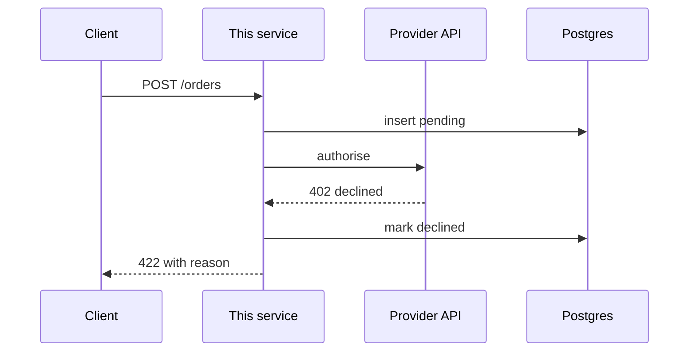

# Repository documentation

## The principle

**Document what changes slowly.**

Boundaries, responsibilities, decisions and operational facts change slowly.
Function signatures, file layouts and parameter lists change constantly and are
read better from the code. A document describing fast-changing things is stale
within a sprint, and a stale document is worse than a missing one because people
still trust it.

## Scope

**Document what the change did. Never audit for gaps.**

Do not survey the repository for missing documentation. That produces a list
nobody acts on, and it buries the one paragraph that actually needed writing. If
something outside the change is badly wrong, say so in one line — do not open a
project.

## Comments versus documents

The no-comments rule applies **inside code**. Markdown exists to explain; that is
its job, and explaining there is correct.

Brevity still applies. Explaining is not padding.

## The documents

| file | answers |
|---|---|
| `README.md` | what is this, how do I run it, where is everything |
| `docs/ARCHITECTURE.md` | where do I make this change |
| `docs/API.md` | how do I call it |
| `docs/openapi.yml` | the machine-readable source for API.md |
| `docs/decisions/NNNN-*.md` | why is it like this |
| `docs/OPERATIONS.md` | it is on fire, what do I do |
| `docs/TROUBLESHOOTING.md` | this symptom, what causes it |

Do not create documents outside this set without a reason. A doc set grows
faster than it is maintained.

### README.md

At the repository root. Two sentences on what the service does and who calls it,
how to run it, how to test it, and **a link to every document under `docs/`**.

Under one screen. It rots slowly because the commands either work or they do not.

Every document is reachable from here. A document nobody can find is a document
nobody reads, and an unread document rots silently.

### docs/ARCHITECTURE.md

Answers the most common question in an unfamiliar repository: where do I make
this change.

Responsibilities and boundaries, named by package:

```
internal/billing   owns invoice state transitions
internal/storage   postgres adapters, no business rules
cmd/server         wiring only
```

**No directory trees and no file listings.** They are stale on the next commit,
and `ls` does the job better. Describe what a package is responsible for, not
what files it contains.

**Diagrams are mermaid, written as code in the markdown.** Never an exported
image — an image cannot be diffed, reviewed, or edited by whoever changes the
flow next.

Use a `flowchart` for structure and a `sequenceDiagram` for flows. **A sequence
diagram must include the external participants, not only this service.** A
diagram that stops at our own boundary hides the part most likely to surprise
someone: who we call, in what order, and what happens when one of them fails.



Include at least one failure path. The happy path is the one everybody already
knows.

Mermaid is for the committed document, where a viewer renders it. Never render it
for terminal output — draw plain text there instead.

Under two screens, diagrams included.

### docs/API.md

Per-endpoint `curl` examples, complete and runnable — real headers, a real body,
pasteable without editing.

When `docs/openapi.yml` exists, these are **generated from it and never
maintained separately**. Two hand-written sources for the same fact disagree
eventually.

No prose restating the endpoint name. The curl is the documentation.

### docs/openapi.yml

Optional, and preferred where it is kept honest.

A spec is only worth having because something consumes it: agents read a spec far
better than prose, and it can be validated against the running service. A spec
nothing checks rots like any document while looking authoritative, which is worse
than having none.

**When a change touches an endpoint, update the spec and regenerate the curls as
part of that change.** If no spec exists yet, write one for the endpoints the
change touches. Do not report a missing or stale spec as a finding for someone
else to pick up — bringing it up to date is the work.

### docs/decisions/NNNN-title.md

One file per decision, numbered.

**Decision records go in their own pull request**, separate from the code that
implements them. A decision reviewed inside a code diff is not reviewed as a
decision — it is skimmed past on the way to the implementation.

Four headings, one page:

```markdown
## Context
## Decision
## Alternatives rejected
## Consequences
```

**Alternatives rejected is the part that earns the file.** Everything else is
recoverable from the code; the roads not taken are not, and that is the question
that gets re-asked every six months.

**Delete or rewrite a record that is wrong or no longer needed.** A record that
misrepresents what was decided is misinformation, not history, and one covering a
decision that no longer matters is clutter.

Where the decision was right at the time and later replaced, prefer a new file
with a line pointing back — "why was it ever like this" still gets asked, and the
old record is the only thing that answers it.

### docs/OPERATIONS.md

Read under stress, so scannable lists rather than prose.

Environment variables and what breaks without each one. How it deploys. Which
dashboards to open. What to do when it is on fire.

Operational curls belong here — health, re-drive, inspect state. Per-endpoint
curls belong in `API.md`, so that a runbook is not buried under reference
material at the moment someone needs it.

### docs/TROUBLESHOOTING.md

Symptom, then cause, then fix. Lead with the symptom, because that is what
someone searches for.

**Link the fix to `OPERATIONS.md` rather than restating it.** A symptom usually
resolves to an operational action — restart, re-drive, check a dashboard — and
that procedure already lives there. Copying it means two versions of the same
runbook step, and the one being read during an incident will be the stale one.

Date anything describing the behaviour of an external system, for the same reason
the findings notes do: it changes without telling you, and a dated observation
can be discounted where a bare claim cannot.

## Amending

Documentation is expected to be revised. When a change is requested, or a later
change makes a document wrong, edit it — that is the normal case, not a repair.

That applies to decision records too — one that is wrong or obsolete is deleted
or rewritten rather than preserved out of principle.

README, architecture, API, operations, troubleshooting and the spec are edited
alongside the code they describe. Decision records are the one thing that moves
in its own pull request.

## Cross-cutting rules

- **Link, never duplicate.** The same fact in two documents disagrees eventually,
  and nothing tells you which one is current.
- **Date anything describing external reality.**
- **If a document cannot be skimmed in a minute, it will not be read.**
- **Write no document that has nothing to say.** An `ARCHITECTURE.md` containing
  only headings is worse than its absence — it reads as though the question has
  been answered.

## Do not write

- a document per package
- a hand-written API reference when a spec exists
- a CHANGELOG; git already holds it
- an onboarding guide; the README is that
- a survey of what is undocumented
